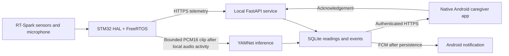

# System Design

## Data flow

## Target firmware task model

The current firmware creates the task/queue skeleton and samples only a scheduler heartbeat. Sensor, audio, network, and local UI loops remain inactive until the board revision and peripherals are verified.

- DMA interrupt captures microphone samples and wakes the audio task. The acquisition callback does not perform network work or model inference.
- Sensor task samples verified sensors every second and sends snapshots to a queue.
- Audio task runs local activity gating, prepares a maximum two-second clip, and queues it for transport. No continuous raw audio is retained or streamed.
- Network task sends telemetry every five seconds and only triggered audio clips. It uses bounded queues and reconnect backoff; a failed network does not block sensor acquisition.
- UI/alarm task updates the display/LED/buzzer and reads local acknowledge/mute/test actions.
- Health/log task records fault counters, task stack high-water marks, heap, and watchdog health where configured.

The current task priorities and stack sizes are provisional. Bus instances, pins, clock source, TLS transport, and actual task behavior must be measured after board verification.

## API contract

- `POST /api/v1/devices/{device_id}/telemetry`: UTC capture time, sequence, temperature, humidity, light, proximity state, device tilt, Wi-Fi RSSI, firmware version, and sensor faults.
- `POST /api/v1/devices/{device_id}/audio-windows`: exactly two seconds of 16 kHz, mono, signed PCM16 plus capture-time, sequence, and sample-rate headers. The route accepts bounded input only and never persists the body.
- `GET /api/v1/devices/{device_id}/latest` and `GET /api/v1/readings`: latest and historical readings for the app.
- `GET /api/v1/events`: chronological events, filterable by device.
- `POST /api/v1/events/{event_id}/acknowledgement`: idempotent caregiver acknowledgement.
- `POST /api/v1/app/installations`: register an Android FCM installation token.
- `/health`: service readiness only; it does not assert that the monitoring environment is safe.

Device and app credentials are separate bearer tokens. Device upload uses TLS; production Firebase service credentials stay on the backend.

## Alert behavior

- Cry threshold is selected on validation data, with recall prioritized. A cry event requires two adjacent model frames above threshold and is keyed by device/audio sequence to prevent retry duplicates.
- Environment settings start at 18–30 °C and 30–70% RH as demonstration comfort bands only. An alert is generated after three consecutive readings outside a band and remains one event until readings return in range.
- Sensor faults, stale data, network loss, inference unavailability, and queue exhaustion are explicit fault states. They never imply that no cry is occurring or that conditions are safe.
- FCM delivery follows event persistence. Failed push delivery is logged without deleting the event.
